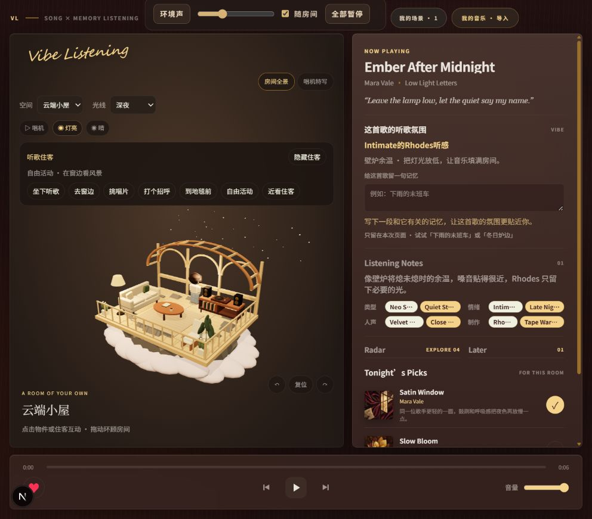
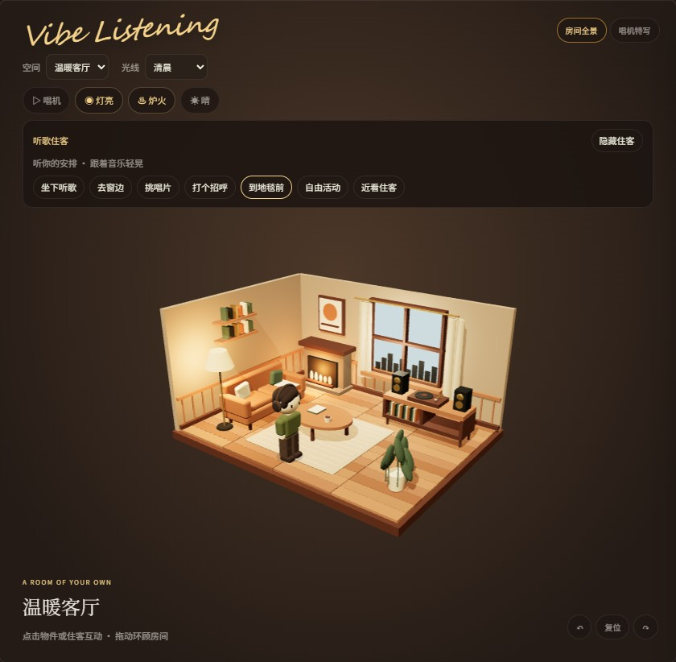
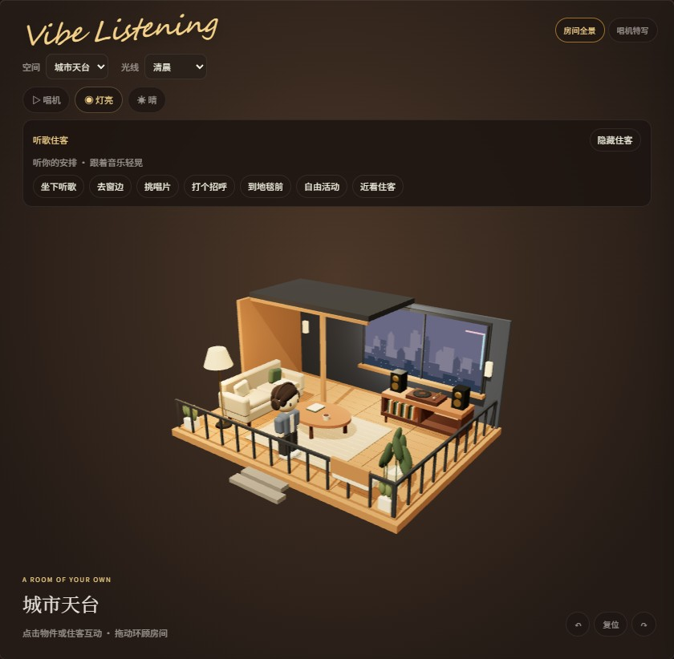
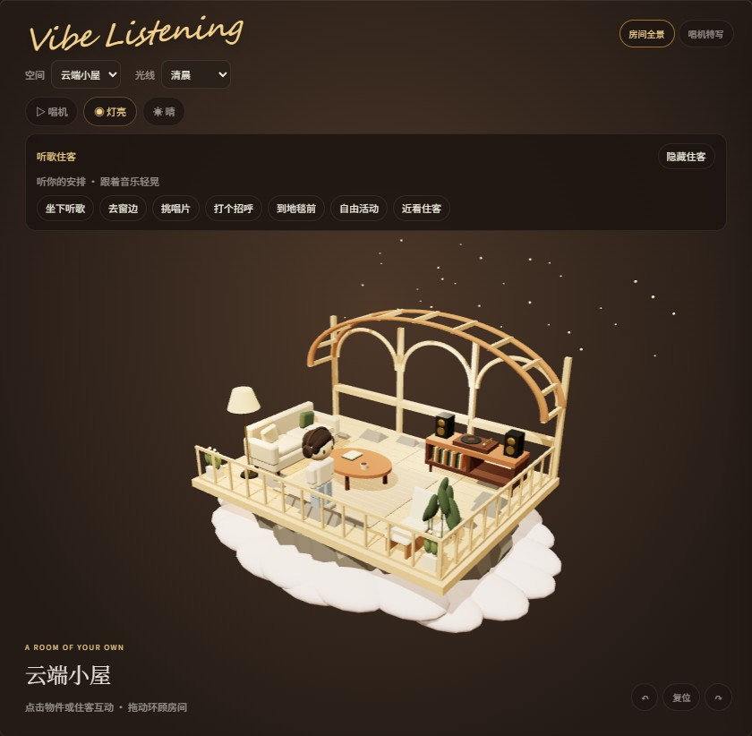
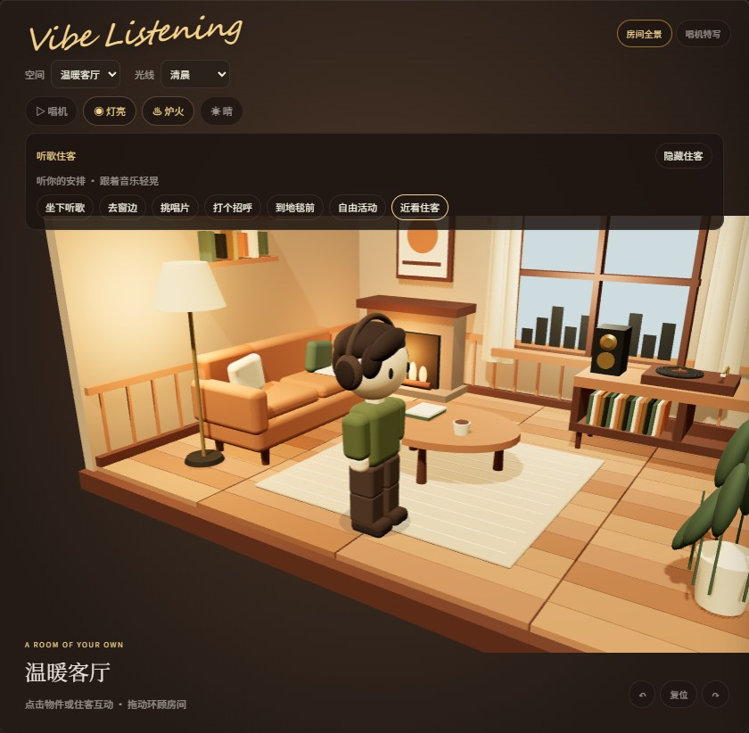
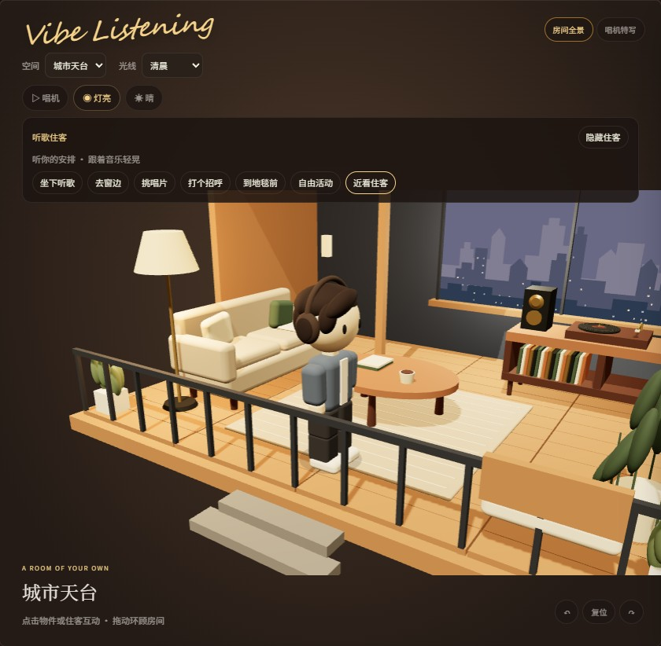
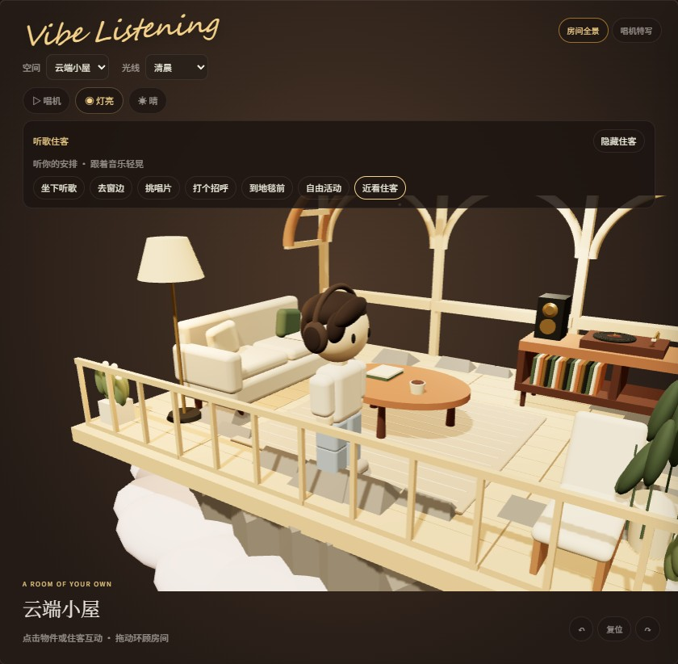

# Vibe Listening

### 给每首歌一个可以待下来的房间。

把自己的音乐放进一个小小的三维空间。在温暖客厅里听雨，在城市天台上等夜色，或去云端小屋放空。戴着耳机的住客会在房间里走动，也会回应你的一声招呼。

**[在线体验 →](https://vibe-listening-preview.vercel.app/)** · [导入音乐](#把自己的音乐带进来) · [本地运行](#本地运行) · [反馈与建议](https://github.com/HuJohnXuan/vibe-listening/issues)

*A personal 3D listening space, with local music, changing moods, and a little companion.*

无需注册，也无需 API Key。建议用电脑浏览器打开，导入一首喜欢的歌开始体验。



*上图来自 V0.2 本地运行页面；下方三张空间图来自当前线上版本。V0.2 提交并部署后线上版才会同步。*

## 一个可以参与的听歌空间

### 三种房间，三种停留的方式

| 温暖客厅 | 城市天台 | 云端小屋 |
| :---: | :---: | :---: |
| [](docs/images/space-cabin.jpg) | [](docs/images/space-rooftop.jpg) | [](docs/images/space-cloud.jpg) |

| 空间 | 听歌时的风景 | 住客穿搭 |
| --- | --- | --- |
| **温暖客厅** | 沙发、黑胶、壁炉与窗外的雨雪 | 苔绿上衣、棕色长裤 |
| **城市天台** | 开阔的城市远景，把音乐留给夜色 | 蓝灰夹克、深色长裤 |
| **云端小屋** | 云上的幻想空间，适合暂时放空 | 米白上衣、灰蓝长裤 |

房间可以跟随歌曲的曲风与情绪标签切换，也可以由你选定。再挑一个清晨、黄昏或深夜，调出此刻想要的光线。

拖动视角、滚轮缩放，靠近看看唱片；点击唱机播放或暂停，点击落地灯切换明暗，在客厅点燃壁炉，或点击窗户让天气在晴、雨、雪之间变化。常用操作也提供可通过键盘访问的按钮。

### 房间里，有一个陪你听歌的人

| 客厅 · 苔绿上衣 | 天台 · 蓝灰夹克 | 云端 · 米白上衣 |
| :---: | :---: | :---: |
| [](docs/images/resident-cabin.jpg) | [](docs/images/resident-rooftop.jpg) | [](docs/images/resident-cloud.jpg) |

住客戴着耳机，保留简单的眼睛和安静的表情。他会偶尔换个地方待着，播放时轻轻晃动，并随房间更换衣服。

你可以点击他打招呼，点沙发让他坐下，点唱片柜让他过去看看，也可以安排他去窗边，或在可达的空地走动。想让房间安静一点时，随时隐藏住客或恢复自由活动。

这是一个轻量的陪伴角色：活动沿预设通道展开，没有对话系统。系统开启“减少动态效果”时，会减少自主走动与循环动画。

### 一首歌，也可以有属于你的天气

在歌曲记忆里写下 **“下雨的末班车”**，或 **“冬日炉边”**。歌曲标签提供基础氛围，记忆中的天气与时间关键词进一步影响灯光和雨雪。

记忆通过本地关键词规则处理，无需调用 AI。每首歌的文字在当前页面内保留，**刷新后清空，不上传、不持久保存**。

## 把自己的音乐带进来

1. 打开 [在线版](https://vibe-listening-preview.vercel.app/)，点击顶部 **“我的音乐 · 导入”**。
2. 选择或拖入音频文件，可一次导入多首。
3. 播放音乐，选择房间；需要时编辑歌曲资料、情绪与默认空间。

支持导入 **MP3、M4A、AAC、WAV、FLAC、Ogg、Opus**，单首最多 **100 MB**。实际播放支持取决于浏览器与文件编码。

- **自动读取资料**：从文件内嵌标签读取歌名、歌手、专辑、曲风、封面，并读取时长；缺少歌名时使用文件名。
- **完整播放与管理**：调整进度和音量、修改资料、移除曲目；相同内容的文件会被识别为重复。
- **连续听歌**：统一队列支持下一首、队尾、排序、移除，以及顺序、随机、列表循环和单曲循环。
- **整理曲库**：按歌名/歌手搜索，按房间、情绪和收藏筛选，并建立自己的本地歌单。
- **回来继续**：队列、当前歌曲、进度、音量、收藏和歌单会在当前浏览器恢复；恢复后保持暂停。
- **可选音频估算**：在编辑面板估算节奏与响度，结果可保存。它不自动识别曲风或情绪，也不驱动角色精准踩拍。

**你的音乐留在自己的浏览器里。** 音频和资料保存在当前设备、当前浏览器、当前网站地址下，刷新后仍可使用；不会上传到服务器，也不跨设备同步。移除曲目只删除应用副本，不影响原文件。

清理网站数据会清空本地曲库，请保留原始音频。换浏览器、换设备，或从本地版切换到在线版，都需要重新导入。

> 想先看看效果？内置 10 首虚构演示曲目，每首提供 6 秒合成试听。导入自己的音频后即可完整播放；项目不提供商业歌曲下载或在线音乐搜索。

## 继续发现音乐

播放器还保留了几种探索方式：

- **Tonight’s Picks**：最多三首推荐，附上推荐理由。
- **Radar**：沿四条发现路线探索曲目。
- **Later**：把想听的歌放进稍后播放队列。
- **Listening Notes**：查看歌曲的听感标签与短评。

推荐基于已有曲目关系和标签匹配，在本地运行。它不会从互联网补充歌曲；本地曲目缺少相关标签时，可能没有推荐结果。

顶部的 **“我的场景”** 可以保存房间、光线、天气、住客偏好和环境声。恢复场景不会自动切歌；若关联歌单已删除，房间仍可恢复。环境声由浏览器在设备内生成，首次与刷新后都需要主动开启，并有独立音量和“全部暂停”。

## 本地运行

需要 **Node.js 22.x**。

```bash
git clone https://github.com/HuJohnXuan/vibe-listening.git
cd vibe-listening
npm ci
npm run dev
```

打开终端显示的地址即可，无需配置环境变量或数据库。

```bash
npm run build  # 生成生产版本
npm run start  # 启动生产预览
```

线上版托管于 Vercel。音乐导入、资料解析与本地曲库保存均在浏览器端完成。

## 当前阶段

Vibe Listening 是持续迭代中的个人项目，主要面向支持 WebGL 的现代桌面浏览器。WebGL 不可用时会回退到唱机视图。

- 阶段 A、B 已在本地实现：连续队列、搜索/收藏/歌单、会话恢复、听歌场景、程序化环境声和住客动作衔接。
- 房间与住客采用程序化三维造型；角色“挑唱片”通过走近、转向和停留表达。天台远景会随清晨、黄昏和深夜改变天空与窗灯。
- 房间氛围依据标签与关键词匹配，尚未实现实时音频情绪识别。
- 尚未针对手机重新设计，也未验证全部音频编码和大曲库性能。

更多操作细节、音频估算范围与已知限制见 [房间、住客与本地音乐库](docs/RESIDENT_PREVIEW.md)。

## 开发与文档

**Next.js 16 · React 19 · TypeScript · Three.js · IndexedDB**

场景几何由代码构建，无需下载外部 3D 模型；音频标签使用 `music-metadata` 解析。

```bash
npm test       # 构建 Next.js 并运行 Node 测试
npm run lint   # 检查代码规范
```

| 文档 | 内容 |
| --- | --- |
| [房间、住客与本地曲库](docs/RESIDENT_PREVIEW.md) | 空间切换、角色操作、导入与存储边界 |
| [3D 房间](docs/3D_ROOM.md) | 场景互动、渲染策略与参考来源 |
| [架构](docs/ARCHITECTURE.md) | 页面、核心逻辑、服务与适配层 |
| [数据模型](docs/DATA_MODEL.md) | 曲库字段与推荐关系 |
| [测试](docs/TESTING.md) | 测试覆盖与检查方式 |
| [V0.2 验收记录](docs/ITERATION_ACCEPTANCE_2026-10-17.md) | 阶段 A/B 的自动检查、浏览器证据与数据边界 |
| [迭代基线](docs/ITERATION_PLAN.md) | 已实现范围、设计基线与阶段 C 候选 |
| [后端产品分析](docs/BACKEND_PRODUCT_ANALYSIS.md) | 高星开源参考、后台数据模型与渐进迁移路线 |
| [未来 API](docs/FUTURE_API.md) | 外部服务接入设想 |
| [变更日志](CHANGELOG.md) | 已完成的迭代 |

播放器、房间和曲库界面位于 `src/ui/player/`，核心逻辑位于 `src/core/`，本地数据适配位于 `src/adapters/local_data/`，页面样式位于 `app/globals.css`。

## 一起把房间变得更好

如果这里让你愿意多听一首歌，欢迎点一个 **Star**，下次再回来坐坐。

想要新的空间、发现了问题，或有更好的互动点子，欢迎 [提交 Issue](https://github.com/HuJohnXuan/vibe-listening/issues) 或 PR。反馈问题时，请附上浏览器、窗口尺寸和复现步骤。

感谢 [Three.js](https://github.com/mrdoob/three.js) 提供渲染基础，以及 [cozy-room-3d](https://github.com/hugozap/cozy-room-3d) 带来的空间构成灵感；参考与采用范围见 [3D 房间文档](docs/3D_ROOM.md)。

## 可选账号同步（P1）

配置 Supabase 后，可用邮箱登录并同步收藏、歌单、场景、房间偏好和本设备续播。音频、封面、路径和歌曲记忆始终保留在本机；另一设备需要自行导入音乐。配置页面与逐项步骤见 [Supabase 配置](docs/SUPABASE_SETUP.md)。
